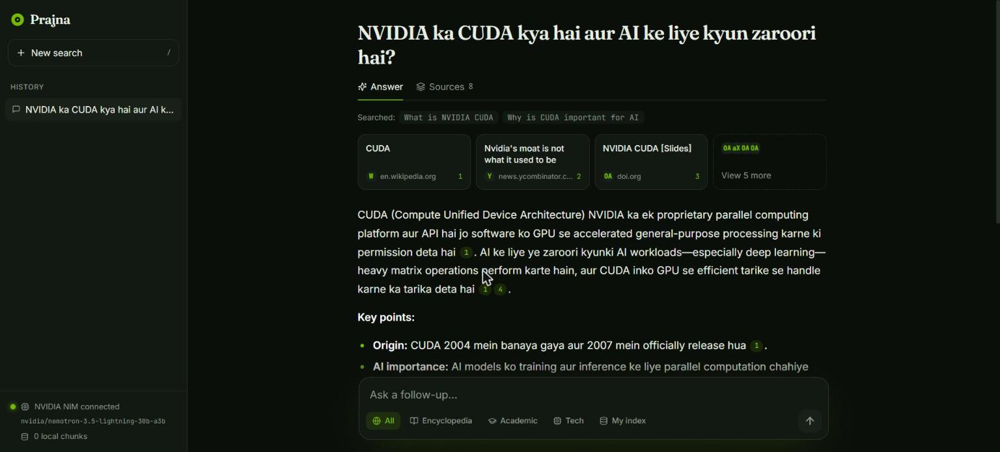
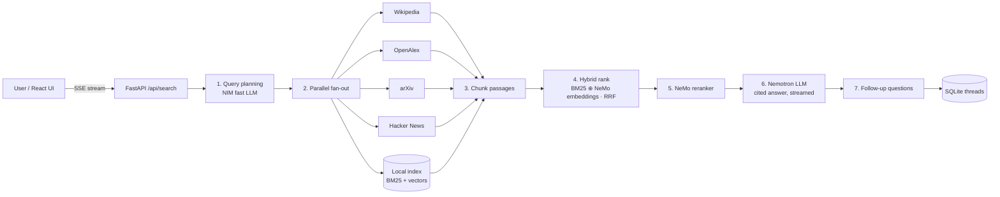

# Prajna — Open-Source AI Answer Engine (powered by NVIDIA NIM)

Prajna (Sanskrit: *wisdom*) is a Perplexity-style AI search engine. You ask a question in English, Hindi or Hinglish. Prajna searches open data sources, ranks the passages with NVIDIA NeMo Retriever models and streams back a grounded answer, with a numbered citation on every claim.

[](https://github.com/pateldixit28603/prajna-ai-search/actions/workflows/ci.yml)
[](https://github.com/pateldixit28603/prajna-ai-search/actions/workflows/daily.yml)
  

### 🔴 Live: **[prajna-ai-search.onrender.com](https://prajna-ai-search.onrender.com)**. Ask it anything in English, Hindi or Hinglish.
<sub>Free hosting: if nobody has used it for a while, the first search takes about a minute to wake the server.</sub>



**It runs every day without anyone touching it.** A GitHub Actions job:
- 📰 **[Prajna Daily](DIGEST.md)** takes the day's trending topics from Wikipedia's most-read list and the Hacker News front page, researches each one, and publishes cited answers ([web version](https://pateldixit28603.github.io/prajna-ai-search/)).
- 📊 **[Benchmark](EVAL.md)** re-runs a fixed set of 24 questions in English, Hindi, Hinglish, Russian, Spanish, Chinese and Arabic, across encyclopedia, academic and tech topics. It tracks answer accuracy, retrieval recall, citation coverage and validity, faithfulness and latency, with the [full history](backend/eval/results/history.csv) kept so you can see the trend.

---

## What it does

| Feature | How |
|---|---|
| **Answer in 7 languages** 🆕 | One click re-renders any answer in English, 简体中文, हिन्दी, Español, العربية (right-to-left), Русский or Hinglish with the NIM LLM. No new search, and every `[n]` citation is checked and restored so it points at the same source. Pick the language before searching too (auto-detected from the script by default); non-English questions also search that language's Wikipedia (ru/zh/hi/es/ar). The choice is saved with the thread |
| **Create images** 🆕 | *Create image* mode: NVIDIA visual GenAI (FLUX.1 / FLUX.2 / Stable Diffusion 3 via `ai.api.nvidia.com/v1/genai`), with Nemotron Bolt expanding your idea into a detailed prompt. Square / wide / tall, variations, download, saved in history |
| **Research mode** 🆕 | A *Research* tab on every answer: key, foundational (most-cited) and rising papers with citation counts and free full-text links, a "read next" list, and a publications-per-year timeline, all from OpenAlex (CC0) |
| **Conversational search** | Threads with follow-ups; the LLM rewrites "its price?" into a standalone query |
| **Open data sources** | Wikipedia (any language, auto-Hindi for Devanagari), OpenAlex (250M+ papers, CC0), arXiv, Hacker News, plus your own local index |
| **Hybrid retrieval** | BM25 (lexical) ⊕ NVIDIA `nemotron-3.5-embed-1b` embeddings (semantic), fused with Reciprocal Rank Fusion |
| **Neural reranking** | NVIDIA `nemotron-3.5-rerank-8b` cross-encoder picks the best passages |
| **Grounded answers** | NVIDIA Nemotron LLM streams Markdown answers with `[n]` citations (reasoning `<think>` blocks are filtered out) |
| **Focus modes** | All · Encyclopedia · Academic · Tech · My index |
| **Local knowledge base** | Ingest the Simple-English Wikipedia dump, chosen Wikipedia articles, or your own `.md/.txt/.jsonl` |
| **Runs anywhere** | Hosted NVIDIA API (no GPU) **or** fully self-hosted NIM containers on your own GPU |
| **Graceful degradation** | No key? It still works in *extractive mode* (cited sentence extraction) |

## Architecture



```
prajna/
├── backend/
│   ├── app/
│   │   ├── main.py            FastAPI app, SSE search endpoint, threads API, serves built UI
│   │   ├── pipeline.py        the 7-stage answer engine
│   │   ├── nvidia.py          NIM client: chat stream, embeddings, rerank, <think> filter
│   │   ├── prompts.py         all prompts in one place
│   │   ├── fallback.py        extractive answers when no NVIDIA endpoint is configured
│   │   ├── store.py           SQLite conversation history
│   │   ├── ratelimit.py       per-IP sliding-window limiter
│   │   ├── sources/           wikipedia.py, openalex.py, arxiv.py, hackernews.py
│   │   └── retrieval/         bm25.py, fusion.py (RRF, cosine, MMR), text.py, local_index.py
│   ├── scripts/ingest.py      build the local open-data index
│   ├── eval/                  benchmark questions, run_eval.py, results/history.csv
│   └── tests/                 19 tests, all NVIDIA + network calls mocked
├── frontend/                  React 18 + TypeScript + Tailwind v4
├── deploy/docker-compose.gpu.yml   self-hosted NIM LLM + embed + rerank on your GPU
├── docker-compose.yml         app with hosted NVIDIA API
└── Dockerfile                 multi-stage: builds UI, serves it from FastAPI
```

## Quick start (local dev)

**Requirements:** Python 3.11+, Node 20+, and a free NVIDIA API key from [build.nvidia.com](https://build.nvidia.com). Click a model, then **Get API Key**. The key starts with `nvapi-`.

```bash
cp .env.example .env              # paste your NVIDIA_API_KEY
make install                      # venv + npm install
make dev-api                      # terminal 1 -> http://localhost:8000
make dev-web                      # terminal 2 -> http://localhost:5173
```

Optional: build a local knowledge base.

```bash
make ingest-demo                                                  # a few full Wikipedia articles
cd backend && .venv/bin/python -m scripts.ingest hf-wikipedia --limit 20000   # Simple English Wikipedia dump (Hugging Face)
cd backend && .venv/bin/python -m scripts.ingest files ~/my-notes            # your own .md/.txt/.jsonl
```

## Deploy (live link, auto-updates from GitHub)

[](https://render.com/deploy?repo=https://github.com/pateldixit28603/prajna-ai-search)

`render.yaml` sets up a free Render web service from this repo's Dockerfile. Render redeploys on every push to `main`. Enter `NVIDIA_API_KEY` when Render asks for it. Free instances sleep when idle, so the first request after a while takes about a minute.

## Production (Docker)

```bash
docker compose up --build                                   # hosted NVIDIA API, no GPU needed
docker compose -f deploy/docker-compose.gpu.yml up --build  # 100% self-hosted on your NVIDIA GPU
```

The GPU stack runs three NIM containers (`llama-3.1-8b-instruct`, `llama-3.2-nv-embedqa-1b-v2`, `llama-3.2-nv-rerankqa-1b-v2`). It needs the NVIDIA Container Toolkit and an NGC key. The app talks to them over the same OpenAI-compatible APIs, so you don't change any code. Only the env vars change.

## Where NVIDIA is used

| Stage | Model (default, configurable) | Endpoint |
|---|---|---|
| Query planning + follow-ups | `nvidia/nemotron-3.5-bolt-e4b` | `POST /v1/chat/completions` |
| Answer generation (streaming) | `nvidia/nemotron-3.5-lightning-30b-a3b` | `POST /v1/chat/completions` (`stream: true`) |
| Passage + query embeddings | `nvidia/nemotron-3.5-embed-1b` | `POST /v1/embeddings` (`input_type: query/passage`) |
| Reranking | `nvidia/nemotron-3.5-rerank-8b` | hosted `…/retrieval/…/reranking` or local `/v1/ranking` |

Hosted models get retired over time. The daily job runs `python -m scripts.nim_check`, which probes every configured endpoint, discovers the live catalog and records what works in [`nim_status.json`](backend/eval/results/nim_status.json). Retired endpoints are skipped automatically by a circuit breaker, so a retired model never breaks search.

You can swap in a bigger answer model by setting `LLM_MODEL`, for example `nvidia/nemotron-3-ultra-550b-a55b`. Any chat model listed at build.nvidia.com works.

## API

| Method | Path | Description |
|---|---|---|
| `GET` | `/api/health` | NVIDIA status, models, local-index stats, focus modes |
| `POST` | `/api/search` | `{query, focus, thread_id?}` → **SSE** events: `status`, `queries`, `sources`, `token`, `followups`, `done`, `error` |
| `GET` | `/api/threads` | recent threads |
| `GET` | `/api/threads/{id}` | full thread with turns, sources, timings |
| `DELETE` | `/api/threads/{id}` | delete thread |

Interactive docs: `http://localhost:8000/docs`.

## Tests and benchmark

```bash
make test                                        # 20 tests: parsers, BM25, RRF, MMR, chunker, <think> filter,
                                                 # NVIDIA path (mocked), SSE API, threads, digest + eval jobs
cd backend && python -m eval.run_eval            # live benchmark -> EVAL.md
cd backend && python -m scripts.daily_digest     # today's digest -> DIGEST.md + site/
```

To switch the daily job from extractive mode to full NVIDIA NIM answers, add a repository secret named `NVIDIA_API_KEY` under *Settings → Secrets and variables → Actions*.

## Data sources and licenses

| Source | License | Notes |
|---|---|---|
| Wikipedia | CC BY-SA 4.0 | Attribution is shown in the source cards. Set `CONTACT_EMAIL` per the Wikimedia User-Agent policy |
| OpenAlex | CC0 | Uses the polite pool via `mailto` |
| arXiv | per-paper | API terms: keep request rates low |
| Hacker News (Algolia) | public API | |

## Roadmap ideas

- Swap the NumPy vector store for Milvus with NVIDIA cuVS (GPU vector search) above roughly 1M chunks
- Add NemoGuard content-safety and jailbreak-detection NIMs as input/output rails
- Image search via Wikimedia Commons; multimodal answers with a VLM NIM
- Redis-backed rate limiting and caching for multi-instance deploys
- User accounts and shareable thread links
